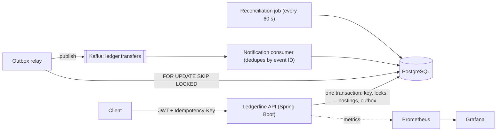
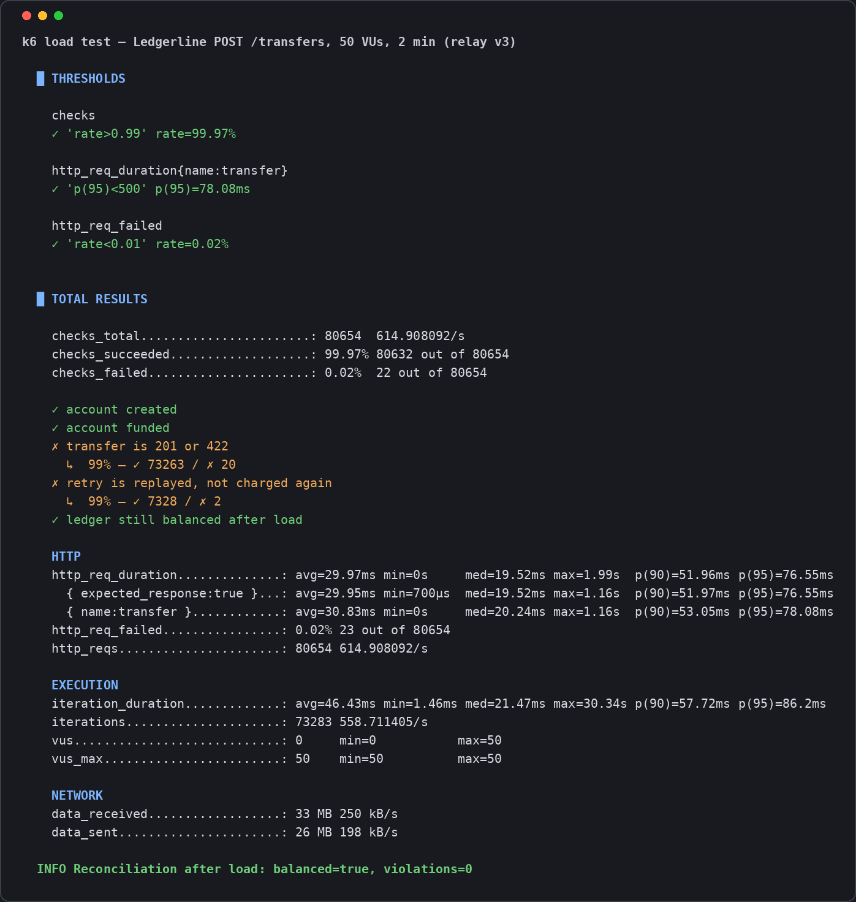
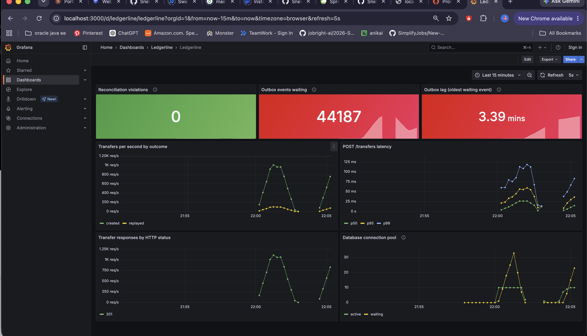
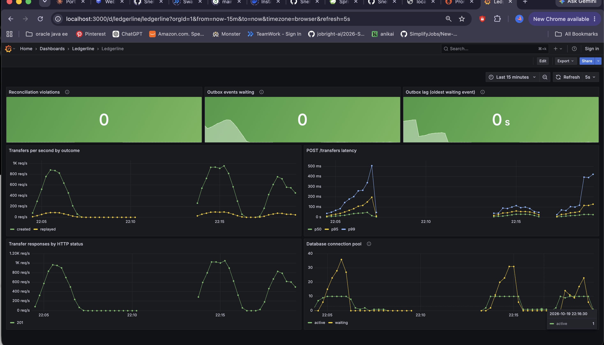
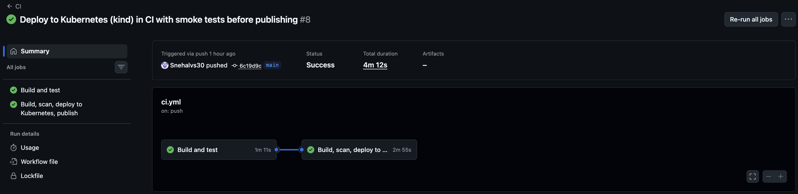
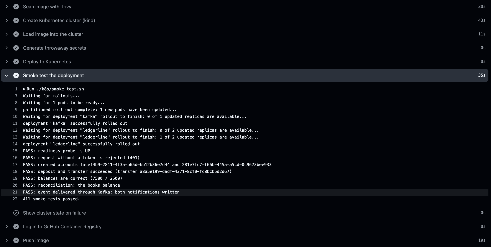

# Ledgerline

[](https://github.com/Snehalvs30/ledgerline/actions/workflows/ci.yml)

**A payments ledger service that stays correct when things go wrong.** Retried requests never charge twice, concurrent transfers never overdraw an account, events are never lost when Kafka is down, and a reconciliation check continuously proves the books balance.

Java 21 · Spring Boot 4 · PostgreSQL · Kafka · Spring Security (JWT) · Testcontainers · Docker · Kubernetes · GitHub Actions · Trivy · Prometheus · Grafana · k6

---

## Why this project

Moving money between accounts sounds simple. The hard part is what happens under real-world conditions:

- A phone times out and **retries a payment**. Was the first attempt processed?
- Two payments hit **the same account at the same moment**. Can both spend the same balance?
- The server **crashes halfway** through a transfer. Is the money moved but the notification lost?
- How do you **know** the balances are still right?

Ledgerline answers each of these with a specific mechanism, and proves it with tests.

## Guarantees

| Guarantee | Problem it prevents | How it's enforced |
|---|---|---|
| **No double charges** | A retried request moving money twice | Client-supplied `Idempotency-Key`, claimed with `INSERT ... ON CONFLICT DO NOTHING` on a primary key, in the same transaction as the transfer |
| **No overdrafts under concurrency** | Two transfers spending the same balance | Row locks (`SELECT ... FOR UPDATE`) taken **in account-ID order** to prevent deadlocks, plus a database `CHECK` constraint as a backstop |
| **Money is never created or destroyed** | Silent balance corruption | Double-entry postings that sum to zero, money stored as integer minor units (cents), and a scheduled reconciliation that exposes violations as a metric |
| **No lost events** | Money moves but downstream systems never hear about it | Transactional outbox, published to Kafka by a relay; consumers deduplicate by event ID, giving an exactly-once *effect* on at-least-once delivery |
| **Users can only touch their own money** | One user reading or spending another's account | JWT scopes plus object-level authorization; someone else's account returns `404`, so IDs can't be enumerated |

## Architecture



### The life of a transfer

In **one database transaction**:

1. **Claim the idempotency key.** If it was already used with the same request, return the original result. If it was used with a *different* request, reject with `422`.
2. **Lock both accounts in ID order**, so no other transfer can change them and opposite-direction transfers can't deadlock.
3. **Check authorization and business rules:** the caller owns the source account, currencies match, funds are sufficient.
4. **Move the money** and write two postings (`-amount`, `+amount`) that sum to zero.
5. **Write a `TransferCompleted` event to the outbox table.**
6. **Commit.** Everything above is saved together, or nothing is.

Then, asynchronously, the relay publishes the event to Kafka, and the consumer writes "you sent / you received" notifications, skipping any event it has already processed.

## Evidence

### Tests: 35 integration tests against real PostgreSQL and Kafka

Every test runs the whole application against containers started by **Testcontainers**, so locking, constraints and messaging behave exactly as in production.

| Area | What's proven |
|---|---|
| **Concurrency** | 500 random transfers on 16 threads between 5 accounts, in both directions: total money unchanged, no negative balances, no deadlocks, reconciliation passes |
| **Idempotency** | Retries replay the original transfer; a reused key with a different body is rejected; 10 simultaneous requests with one key move money exactly once |
| **Outbox** | Events reach Kafka and the consumer; a duplicate delivery creates no duplicate notifications |
| **Security** | Forged, expired and missing tokens get `401`; missing scopes get `403`; users can't read or spend from each other's accounts; customers can't move money out of the system funding account |

### Load test (k6)

50 virtual users for 2 minutes, with 10% of transfers deliberately retried using the same idempotency key.

| Measure | Result |
|---|---|
| Throughput | 615 requests/s average, peaks around 900/s |
| Latency, `POST /transfers` | p50 20 ms, p95 78 ms |
| Retries correctly replayed | 7,328 of 7,330 (the other 2 were client-side connection timeouts) |
| Server errors (5xx) | 0 |
| Reconciliation afterwards | Balanced, 0 violations |

*Measured on a MacBook Air with the app, PostgreSQL, Kafka, Prometheus, Grafana and k6 all on the same machine, before JWT authentication was added. 0.02% of requests failed with client-side connection timeouts from Docker Desktop networking; none reached the application.*



### A bottleneck found and fixed

Load testing showed the outbox relay falling behind: it sent one event, waited for Kafka to confirm, then sent the next. Under sustained load the backlog grew into the tens of thousands and lag reached minutes.



The fix was to **pipeline** sends (send a whole batch, then collect confirmations) and **drain** without sleeping while batches come back full, each batch in its own short transaction. On the same test, the backlog stayed under about 100 events, lag under a second, and it drained to zero as soon as the load stopped.



### Failure tests

| Scenario | Result |
|---|---|
| Kafka stopped during transfers | Transfers kept succeeding; events waited in the outbox and were all delivered when Kafka returned |
| Consumer forced to re-read every event | Every duplicate was skipped; notification count unchanged |
| Balance corrupted by hand in the database | Reconciliation reported the mismatch within a minute |

Details and procedures: [docs/failure-tests.md](docs/failure-tests.md)

## Security

The API is an **OAuth2 resource server**: every request needs a signed JWT, validated for signature, expiry, issuer and audience.

| Scope | Allows |
|---|---|
| `accounts:read` | Read your own accounts |
| `accounts:write` | Create accounts |
| `transfers:write` | Transfer **from your own** accounts (paying into anyone's is allowed) |
| `ledger:admin` | Reconciliation, deposits from the system funding account, any account |

Endpoints not explicitly listed are denied by default. Idempotency keys are scoped per caller, so clients can't collide with or replay each other's transfers. Locally, tokens are signed with HS256 and issued by a dev-only endpoint that doesn't exist outside the `local` profile; in production, tokens would come from an identity provider (Keycloak, Auth0, Cognito) and be verified with its public keys.

## CI/CD and Kubernetes



Every push runs:

1. **Build and test:** all 35 integration tests with Testcontainers
2. **Build image:** multi-stage Dockerfile, JRE-only runtime, non-root user
3. **Scan with Trivy:** fails on HIGH or CRITICAL vulnerabilities that have a fix available
4. **Deploy to Kubernetes:** a throwaway [kind](https://kind.sigs.k8s.io/) cluster with 2 app replicas, PostgreSQL and Kafka
5. **Smoke test the deployment:** probes, authentication, transfers, balances, reconciliation, and an event travelling through Kafka
6. **Publish** to GitHub Container Registry, from `main` only, and only if every step passed



The Kubernetes manifests in [`k8s/`](k8s/) use startup, readiness and liveness probes, rolling updates that never drop below two running pods, resource requests with a memory limit, a non-root read-only container with all capabilities dropped, a PodDisruptionBudget, and secrets that never touch Git.

**What the pipeline caught before anything shipped:**

| Issue | Caught by | Fix |
|---|---|---|
| `POST` and `GET` returned different timestamps for the same account, only on Linux | Tests | Truncate timestamps to PostgreSQL's microsecond precision |
| A GitHub Action version tag removed after a supply-chain attack | Pipeline | Switched to the maintainers' safe tag |
| An unused Go binary in the base image with 3 HIGH CVEs | Trivy | Removed it from the runtime image |
| 9 HIGH and CRITICAL CVEs in Tomcat, Jackson and lz4-java | Trivy | Upgraded to patched versions |

## Running it locally

**Prerequisites:** Docker Desktop and Java 21.

```bash
# Start PostgreSQL, Kafka, Prometheus and Grafana
docker compose up -d

# Run the app with the "local" profile (enables the dev token endpoint)
SPRING_PROFILES_ACTIVE=local ./mvnw spring-boot:run
```

Or run everything, including the app, in containers: `docker compose --profile app up -d --build` (the app is then on port 8081).

**Try it:**

```bash
# Get a token
TOKEN=$(curl -s -X POST localhost:8080/dev/token -H "Content-Type: application/json" \
  -d '{"subject":"alice","scopes":["accounts:read","accounts:write","transfers:write"]}' \
  | sed 's/.*"accessToken":"\([^"]*\)".*/\1/')

# Create an account
curl -X POST localhost:8080/accounts -H "Authorization: Bearer $TOKEN" \
  -H "Content-Type: application/json" -d '{"name":"Alice","currency":"USD"}'
```

| Tool | URL |
|---|---|
| API | http://localhost:8080 |
| Grafana dashboard | http://localhost:3000 |
| Prometheus | http://localhost:9090 |

**Run the tests:** `./mvnw verify` (needs Docker running for Testcontainers).

**Run the load test:** `docker run --rm -i -e BASE_URL=http://host.docker.internal:8080 grafana/k6:1.0.0 run - < loadtest/transfers.js`

## Design decisions

- **Money as integer minor units.** Floating-point arithmetic can't represent most decimal amounts exactly; `5000` cents can't round wrongly.
- **Pessimistic locking in a fixed order**, rather than optimistic locking with retries. Transfers between popular accounts contend heavily, so waiting briefly beats repeatedly failing and retrying; ordering the locks makes deadlocks impossible.
- **Only successful transfers consume an idempotency key.** A transfer rejected for insufficient funds can be retried with the same key after a deposit. (Stripe stores failures too; both choices are defensible.)
- **Reconciliation runs under `REPEATABLE READ`**, so its three checks see one consistent snapshot and a concurrent transfer can't cause a false alarm.
- **A polling outbox relay** rather than change-data-capture (Debezium): simpler to run and reason about at this scale. CDC is the upgrade path for higher volume.

## Limitations and what I'd do in production

- **Single currency per transfer.** No FX conversion.
- **Single-node PostgreSQL and Kafka** in Kubernetes. Production would use managed services (RDS / Cloud SQL, MSK / Confluent) or operators (CloudNativePG, Strimzi).
- **Shared-secret JWTs locally.** Production would validate tokens from an identity provider using its public keys, and keep secrets in a secret manager.
- **Metrics and health endpoints share the public port.** Production would expose them on a separate internal port.
- **Postings live in one table.** At high volume it would be partitioned by time.

## Project structure

```
src/main/java/com/ledgerline/
├── account/          Accounts, ownership, locking queries
├── transfer/         The transfer flow, request fingerprinting, metrics
├── idempotency/      Idempotency key storage
├── ledger/           Journal entries and postings (double entry)
├── outbox/           Outbox writer, Kafka relay, outbox metrics
├── notification/     Idempotent Kafka consumer
├── reconciliation/   Invariant checks, scheduled job, metric
├── security/         JWT resource server, scopes, caller identity
└── common/           Error handling (RFC 9457 problem details)
src/test/java/        35 integration tests (Testcontainers)
k8s/                  Kubernetes manifests and smoke test
monitoring/           Prometheus config and Grafana dashboard
loadtest/             k6 load test
docs/                 Failure tests, screenshots
```